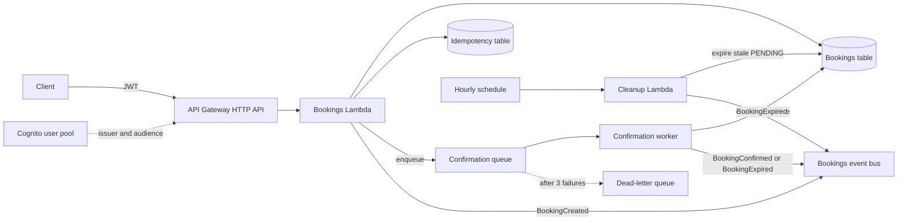

# Bookings API

A serverless REST API for reserving a named resource (a room, a desk, a court) for a time window. Clients send a Cognito JWT. API Gateway (HTTP API) invokes a Python 3.12 Lambda that writes a single DynamoDB table, then an SQS worker confirms the hold. An EventBridge schedule expires holds that never confirm.

This is a portfolio demo for Arpan Bom's CV. **It has never been deployed.** There is no AWS account, no live endpoint, and no measured latency, throughput, or cost. GitHub Actions only lints and tests. It does not deploy and it does not use AWS credentials.

## Architecture



`template.yaml` is an AWS SAM stack. The HTTP routes, the worker, and the schedule are three Lambda functions that share the package in `src/`. Handlers use AWS Lambda Powertools for logging, X-Ray tracing, and idempotency on create.

### Status

| From | To | When |
| --- | --- | --- |
| | PENDING | `POST /bookings` accepts the hold and enqueues confirmation |
| PENDING | CONFIRMED | The worker runs while the slot is still in the future |
| PENDING | EXPIRED | The worker finds the slot has started, or the hourly cleanup finds a PENDING booking older than the timeout |
| PENDING or CONFIRMED | CANCELLED | `DELETE /bookings/{bookingId}` |

CANCELLED and EXPIRED are terminal. The timeout defaults to 30 minutes from `createdAt`, not from the last update. A notes change does not extend the hold.

### Single table

Table keys are `PK = BOOKING#{bookingId}` and `SK = META`.

| Access | Index | Keys |
| --- | --- | --- |
| Get one booking | table | `PK`, `SK = META` |
| List a caller's bookings by start time | `UserBookings` | `userPK = USER#{userId}`, `userSK = START#{start}#{id}` |
| Find stale pending bookings | `StatusCreated` | `statusPK = STATUS#PENDING`, `statusSK < CREATED#{cutoff}` |
| Look for an overlapping hold | `ResourceSchedule` | `resourcePK = RESOURCE#{resourceId}`, `resourceSK` between the slot and 14 days earlier |

Create is idempotent. The `Idempotency-Key` header is stored in a second DynamoDB table through Powertools, scoped per user, for 24 hours. The same key and body return the original booking. The same key and a different body is a conflict. The booking id is a UUID derived from the user and the key, so a retry after a partial failure writes the same item.

`resourceId` is an opaque string. There is no resource catalog.

## API

All routes except `/health` require `Authorization: Bearer <Cognito access token>`. The token's `sub` claim is the caller. Handlers do not call Cognito themselves. API Gateway's JWT authorizer does that, using the user pool as issuer and the app client id as audience. The app client has no client secret.

| Method | Path | Auth |
| --- | --- | --- |
| `GET` | `/health` | none |
| `POST` | `/bookings` | JWT, plus `Idempotency-Key` |
| `GET` | `/bookings` | JWT |
| `GET` | `/bookings/{bookingId}` | JWT |
| `PUT` | `/bookings/{bookingId}` | JWT |
| `DELETE` | `/bookings/{bookingId}` | JWT, cancels the booking |

```json
{
  "resourceId": "room-14",
  "startTime": "2027-03-04T15:00:00Z",
  "endTime": "2027-03-04T16:00:00Z",
  "partySize": 4,
  "notes": "Window seat if you have one"
}
```

`partySize` is 1 to 20. The window must end after it starts, last at most 14 days, and start in the future. Times are UTC. A slot that only touches another at an endpoint is allowed. Two blocking holds on the same resource (PENDING or CONFIRMED) may not overlap. Another caller's booking is returned as not found.

`PUT` on a PENDING booking can change notes, party size, and times. A CONFIRMED booking can change notes and party size only.

There is no local HTTP server. The handlers are exercised by pytest, which builds API Gateway HTTP API events and puts JWT claims where the authorizer would.

## Run

Python 3.12.

```bash
python3 -m venv .venv
source .venv/bin/activate
pip install -r requirements-dev.txt
make check
```

`make check` runs ruff, pytest, `sam validate --lint`, and cfn-lint. Nothing in that command talks to AWS.

`src/requirements.txt` is what `sam build` would install into the functions. `requirements-dev.txt` adds pytest, moto, ruff, cfn-lint, and the SAM CLI.

`samconfig.toml` is gitignored. A guided deploy would write an account id there, and this demo has no deploy config.

Deploy has not been run. The command below is the SAM shape for a later, separate attempt. It needs an AWS account and credentials that this repo does not contain, and it is not part of CI.

```bash
sam build
sam deploy --guided --region us-east-1
```

After a real deploy, the stack outputs would include the HTTP API URL, user pool id, and app client id. Those outputs have never been resolved.

## Test

```bash
pytest
```

moto stands in for DynamoDB, SQS, and EventBridge. Tests cover the single-table queries, the HTTP handlers (including idempotency and auth claims), the confirmation worker, the cleanup schedule handler, and delivery of a `BookingCreated` event to an SQS rule target. They do not call Cognito, and they do not deploy the stack.

CI is `.github/workflows/ci.yml`. It runs ruff, pytest, `sam validate --lint`, and cfn-lint on Python 3.12. It has no deploy step and no AWS credentials. This copy of the repo has not had that workflow executed by GitHub.

## Limits

These are properties of the code, not measured capacity.

- Latency, throughput, and monthly cost: not measured.
- Overlap detection is check-then-write. Two creates racing on the same resource can both succeed. It is not a DynamoDB transaction.
- Cleanup processes at most 100 stale bookings per hourly run. A larger backlog waits for the next schedule.
- List returns at most 100 bookings and sets `truncated` when more exist.
- Domain events and confirmation messages are at-least-once. The worker treats an already confirmed, cancelled, or expired booking as done.
- CORS allows any origin because there is no browser client. A real deployment should restrict it.
- The confirmation worker checks that the hold is still pending and the slot has not started. It does not take payment or notify anyone. Nothing is subscribed to the event bus in this template.

## License

MIT. See [LICENSE](LICENSE).
